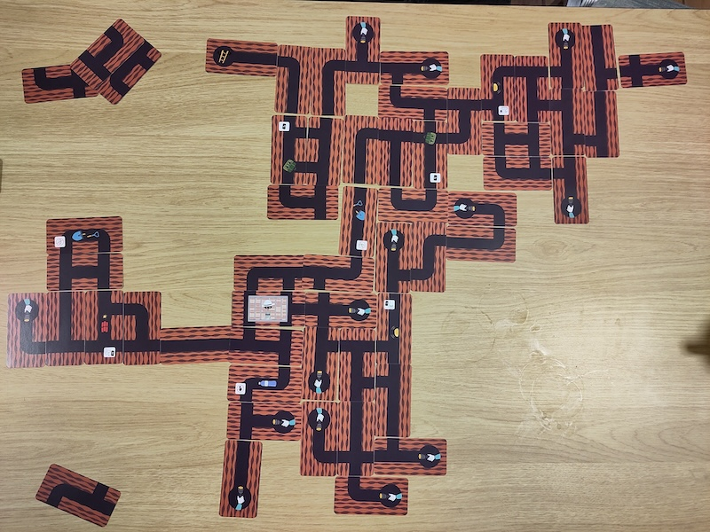
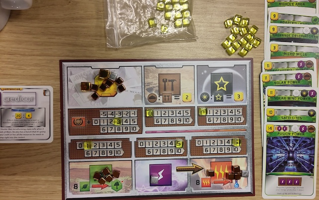
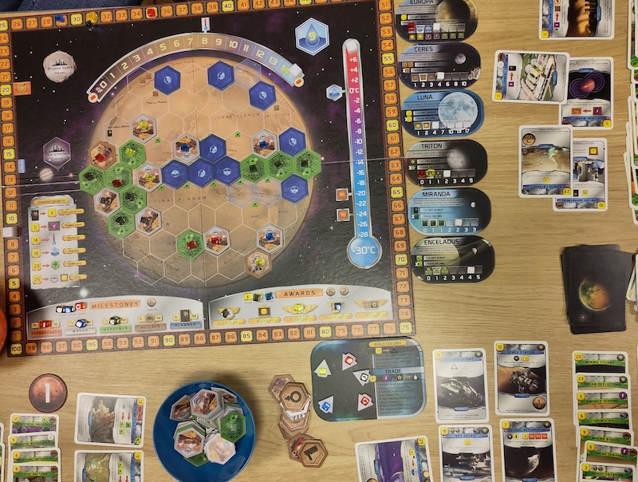
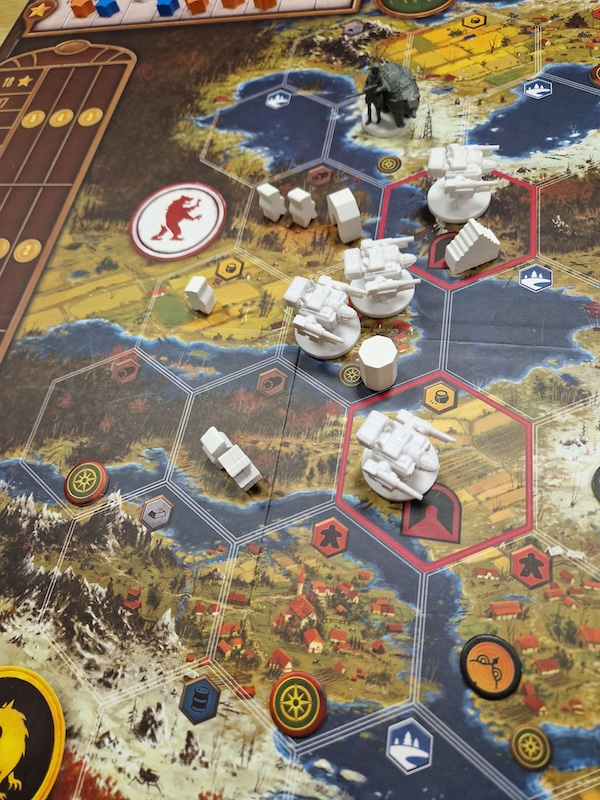
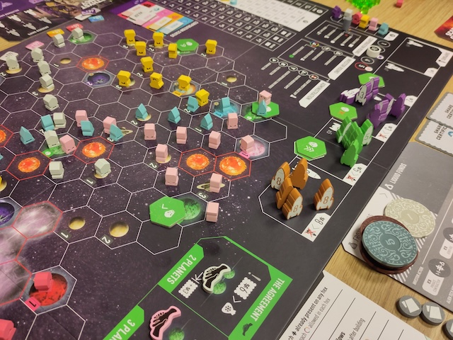

A slightly spaced theme based bias to this session with club favourite Terraforming Mars returning and a new "Space Train" game Stellar Ventures.

{:class="img_post"}

Just one short game this session, but it had two plays, [Bandida][Bdd]. The prequel to this simple maze game [Bandido][Bdo] was played a lot during the lockdown online sessions. It is a cooperative game and the new version brings a few more modes and special cards but the premise is to either prevent Bandida from tunnelling out of jail or to help her. This session we chose to help Bandida, well at least try to, spoiler, both attempts failed. Players have 3 cards with various tunnel combinations on them and they play one to the growing tunnel network on the table and then pick up another. The aim is to close off all the exits with dead-ends, and in the help Bandida version you need to find the escape ladder and connect that in. There are also a few cards with helpful equipment or unhelpful alarms. In both games the ladder card was drawn late in the game and it proved impossible to block off all the exits before the tunnel cards ran out.

{:class="img_post"}

Four players started [Terraforming Mars][TM], all had played at least the base game before, this time the [Colonies expansion][TMC] was included. Richie was the Helios corporation which allowed him to spend heat as money and he quickly built up a nice heat generating engine. Kathy had also been dealt some initial heat related cards so between them and with a little help from the other two players the temperature started rising fast on Mars. Meanwhile only James was really focusing on plants and greenery, as his corporation gave a small bonus to that. Neil was the only player really making use of the moon colonies and hence was acquiring bonus resources unhindered whenever he flew his ships there. Kathy had chosen quite a simple corporation, the Tech bro mega rich one, so she started with a lot of initial cash, though that was soon gone and she had a rebate on expensive cards which started becoming useful in the final turns of the game. 

{:class="img_post"}

Eventually the oxygen levels were maxed and the last water tile placed and it was the final round and scoring. James with his quiet green strategy had the most points from planet scores and victory point cards, Kathy was next with a Science goal bonus and an energy into money strategy, Neil's colonies were third and Richie's heat empire had been successful in the early game but didn't quite deliver the final victory points.

{:class="img_post"}

Steph, Dave and Darren continued their campaign of [Scythe: The Rise of Fenris][SRF] - they managed two games of the multi-game campaign with Steph and Dave winning a game each. 

Simon brought [Stellar Ventures][SV], a new economic game that was still in its shrink wrap so it was ceremoniously unboxed for its first play at club. Its a similar game system to the cube rails train games that have been played [before][127] - but in space! There are 5 corporations at the start of the game to be auctioned off - a sixth comes into play at round 3 - and each one can choose a special power - such as one off cash boost, cheaper wormholes etc. Instead of trains the space companies are building outposts (the cubes/trains!) from their home planet to claim other planets (instead of cities) for minable resources. It wouldn't be a space game though without a few important extras: wormholes - a technology you can acquire for a corp that lets you jump over areas of space; rockets - so you can transport the mined resources back to your planet; aliens - that give you alien tech and you can go into business with them!

{:class="img_post"}

As usual in such an economic game, the corporations can only spend their money to expand their outposts and buying rockets for cargo transport, so you will have to end up selling shares to raise more cash. But there is also a boardroom battle phase where players can try to force a share sell off in a company! Dividends are of course given out to the share holders, but the amount is based on mining resource AND cargo capacity of the companies rockets - if the company doesn't keep these somewhat aligned the dividends will be worth very little!

After a company has visited at least 2 alien planets, they can enter into an agreement with them - this is of course double-sided! On the plus side, you get an immediate cash injection into the company, you get a new special power, and at the end of the game all the shares are worth more. The negative side, you can't earn alien tech any more, and if you don't get a better mining resource score than the aliens (did I mention they have a mining score that goes up when an agreement is started or the rockets get better?) then all the companies shares are only worth 1 at the end of the game!

{:class="img_post"}

The final major wrinkle in a corporations growth agenda is the rocket ships, apart from needing them to allow a good dividend pay-out to share holders the corp can only have 3 max, and they take a round to be delivered - so you can't get instant dividend improvement. Rocket ships start off at level 1 and get better during the game (once all of a level of ships has gone), but when a company buys a level 3 ship, all level 1 ships are made redundant and immediately get binned! So planning for rocket obsolescence is important to stop the dividend price crashing.

Players also get some actions after all the corporations have gone, where they can spend their money to build outposts or other corporation tweaks! They can also use the alien tech to upgrade a company with wormhole tech, or extra cargo capacity. These are quite important decisions to make sure you get the most of your economy, though you only have 2 per round!

{:class="img_post"}

Simon, Jyo and Jeremy sat down for a first go at this new "Trains in spaceeee!" game, and though they had all played similar economic games before, the intricacies of this game were new. So choices of - how much money will the corporation need, so how much should I bid, do I buy 3 rocket ships or only 2, what should I use the alien tech on, how much money will be available for buying shares (this was a problem as the dividend payout come in as frozen assets that you can't spend!). But aside from these questions, the game of expanding our networks and economies went well - with Simon owning Pink corp, Jyo with Blue and Yellow, and Jeremy with Red and White. By the third round, when Purple came on the scene, Simon had only 1 money, so Jyo won the auction ending up with 3 companies she was running. Then both Simon's Pink and Jeremy's White companies entered agreements with the aliens - though Pink was in a much better position to fulfil the contract compared to White. Unfortunately we had to wrap up the first game shortly afterwards - even though there are only 5 rounds, learning the game takes a while. It was at the time of calling, slightly looking in Simon's favour, but all was still to play for. Everyone agreed to give it another go in future.

Next session is on Wednesday November 25th 7.30pm at the St Ives Corn Exchange. This session will be the last games session of the year but will be our annual Charity night, where we will be raising money for East Anglia Childrens Hospice (EACH) through donations, bake sale and a games raffle. So please do come along and join us and help eat the baked treats.

The 9th of December will be the Christmas Meal, a large table has been booked at the Welcome Chinese restaurant but you need to reserve a seat and pay a deposit at the Charity night session or on Discord by the 25th November.

The first session of 2027 will be 6th January, if Santa brought you new Games bring them along and share with the rest of the club.

* Total Session Attendance: 10
* Board Games: 4

	* [Bandida][Bdd]
	* [Scythe: The Rise of Fenris][SRF]
	* [Stellar Ventures][SV]
	* [Terraforming Mars][TM]

[Bdd]: {{site.data.BoardGameLinks.Bandida.Link}}
[Bdo]: {{site.data.BoardGameLinks.Bandido.Link}}
[SRF]: {{site.data.BoardGameLinks.ScytheTheRiseOfFenris.Link}}
[SV]: {{site.data.BoardGameLinks.StellarVentures.Link}}
[TM]: {{site.data.BoardGameLinks.TerraformingMars.Link}}
[TMC]: {{site.data.BoardGameLinks.TerraformingMarsColonies.Link}}

[Contact]: /Contact.html

[127]: /2026/05/27/127th-session.html

