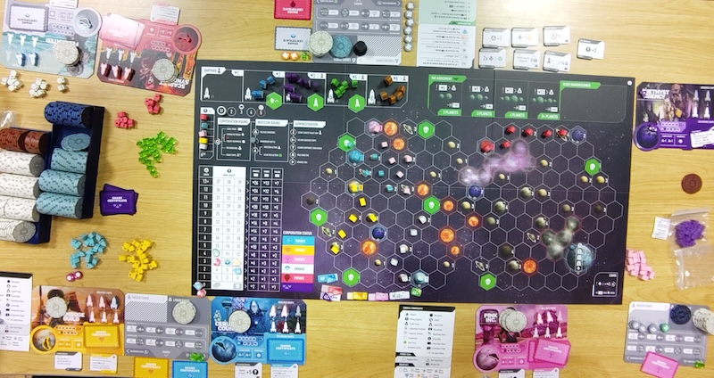
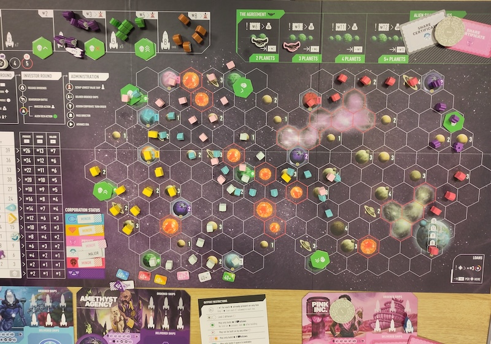

A slightly spaced theme based bias to this session with club favourite Terraforming Mars returning and a new "Space Train" game Stellar Ventures.

{:class="img_post"}

Just one short game this session, but it had two plays, [Bandida][Bdd]. The prequel to this simple maze game [Bandido][Bdo] was played a lot during the lockdown online sessions. It is a cooperative game and the new version brings a few more modes and special cards but the premise is to either prevent Bandida from tunnelling out of jail or to help her. This session we chose to help Bandida, well at least try to, spoiler, both attempts failed. Players have 3 cards with various tunnel combinations on them and they play one to the growing tunnel network on the table and then pick up another. The aim is to close off all the exits with dead-ends, and in the help Bandida version you need to find the escape ladder and connect that in. There are also a few cards with helpful equipment or unhelpful alarms. In both games the ladder card was drawn late in the game and it proved impossible to block off all the exits before the tunnel cards ran out.

{:class="img_post"}

Four players started [Terraforming Mars][TM], all had played at least the base game before, this time the [Colonies expansion][TMC] was included. Richie was the Helios corporation which allowed him to spend heat as money and he quickly built up a nice heat generating engine. Kathy had also been dealt some initial heat related cards so between them and with a little help from the other two players the temperature started rising fast on Mars. Meanwhile only James was really focusing on plants and greenery, as his corporation gave a small bonus to that. Neil was the only player really making use of the moon colonies and hence was acquiring bonus resources unhindered whenever he flew his ships there. Kathy had chosen quite a simple corporation, the Tech bro mega rich one, so she started with a lot of initial cash, though that was soon gone and she had a rebate on expensive cards which started becoming useful in the final turns of the game. 

{:class="img_post"}

Eventually the oxygen levels were maxed and the last water tile placed and it was the final round and scoring. James with his quiet green strategy had the most points from planet scores and victory point cards, Kathy was next with a Science goal bonus and an energy into money strategy, Neil's colonies were third and Richie's heat empire had been successful in the early game but didn't quite deliver the final victory points.

Last seen in [Session 83][83], [Scythe][Scy] sees players take control of various factions in an alternative 1920’s Europe where Nikola Tesla’s advanced technologies have brought both wonders and devastation to bear. The asymmetrical factions have workers for producing resources, giant mechs for combat, and leaders for encounters and combat, with actions being chosen from the four available on a players’ board, choosing a different option each turn. Main actions such as moving or producing resources are linked to an optional action such as building structures or deploying mechs, with each board having a different layout. Each player also has 6 stars they can use to claim various set objectives – winning a combat, deploying all 4 of their mechs, completing their objective card and the like. If a player places all 6 stars end game is triggered. 

{:class="img_post"}

Throughout the game players will lose or gain Popularity, Power and cash, with power relating to combat and popularity being a multiplier for end game scoring, which is based on number of stars, territory controlled and left-over resources. There’s also a bonus public objective, normally based on building structures in specific places, and all points are taken as cash to be added to the cash collected during the game. 

Steph, Dave and Darren were in the middle of the campaign expansion [The Rise of Fenris][SRF] which they had been playing at pub nights, and were planning to try and get a couple of games in with the freedom of a club night. The campaign throws various changes in, with there being possibilities to change up star objectives, form alliances or even swap out the faction being played, all depending on the scenario, with 8 games forming the campaign. Money from each game is carried over to allow the buying of various upgrades and perks, but doesn’t count towards the final game. The campaign had started with Dave taking control of the Polonia Republic, Darren taking the Togawa Shogunate, and Steph running the Nordic Kingdoms.

Game 5 produced a new shiny thing – the unknown Box C, which was placed on the board, to be opened if anyone reached it, to reveal its contents. Having a shiny thing in view was too much temptation for Darren who rushed towards it as fast as he could, only to find it wasn’t quite as shiny as he’d hoped when he did get there and was forced to retreat to his home base. New end game conditions were encountered as a result, with there being some tricky decisions to make around how to proceed. Undeterred, Darren went for the new conditions and ended the game far quicker than had been expected. Not the best move for him as it turned out, having very little cash in his reserves and not many stars out due to it being so early in the game. It was low scores all round, but his miserable 14 lost out badly to Dave’s 26 and Steph’s 30. The end of the game produced some new details for the next game, and there was a chance to buy some more upgrades ready for the next game, with both Dave and Steph taking advantage.

Game 6 provided a new box to be opened ahead of the game, creating some interesting new conditions for the scenario, and some unexpected consequences for Darren. Resource production was the first step for everyone in order to prep for the upcoming storm, and then Darren was making some aggressive moves, deploying mechs as fast as he could and bouncing his leader across the board, somewhat dictated by the conditions he had found himself under. Steph and Dave had to think a little about their moves to try and avoid some of the negative point tokens that Darren was leaving in his wake. Dave was mean while racing up the popularity track, (helped by his ability to take 2 options instead of one when resolving an encounter – these are placed at various points across the board and let characters that enter the space flip a card with 3 options on) and Steph was building structures for the public objective. Darren continued to be a pest and found that the aggressive play style he was having to take was actually netting him more stars than usual. Enough in fact to get him all 6 and end the game.

Unfortunately it turned out that his aggression had not helped his bank balance, partly because his rush to build all his mechs had utilised an ability card rather than the usual method from his player board, so hadn't been gaining bonus cash. The aggressive play also hadn't helped his popularity and so ended way down the table with a meagre 36 points. Steph's buildings helped her garner 84, whilst Dave managed to secure 96 to take the win. The game's conclusion further revealed that each player now had the option to change faction for the next game if they so wished... 

*Battle reports from the Europan Conflict being sent on from Whitehall now...*

<b>**** FOR YOUR EYES ONLY ****</b>

 
***
  
<i>The following notes on the Europan conflict have been taken from Major Tom Haversham's journal, 3rd Reconnaissance Battalion, Royal Albion Intelligence Corps.</i>
  
15th April 1923 
  
Reports from all reconnaissance teams appear to show no sign of the Togawa Shogunate forces anywhere in Europa following the unconfirmed reports that <b>REDACTED</b> had been found in Transylvania. We had confirmed reports of their presence in multiple regions and this sudden disappearance is most disturbing.
  
Regiments from the Polania Republic were amassing stockpiles, and intelligence suggested they were planning to march on the site of Tesla's factory, so further scouts under Sgt Jenkins were dispatched as the reports coming from Transylvania are garbled and full of contradictions recently.
  
Cpl Smythe's team had been keeping an eye on the Nordic contingent and had been following them as they moved South. It seems likely they are also headed towards Transylvania. If <b>REDACTED</b> has truly surfaced then this could be a tipping point in the conflict, and we should be prepared for anything. 
  
21st April 1923
  
Still no sightings of the Shogunate forces, their silence is unnerving. Jenkins and Smythe are now deep in Transylvania, and I have further dispatched 2 squads under Sgt Letherbridge as there has been a disturbing development, confirmed by both extant teams. <b>REDACTED</b> is alive and has seemingly gathered an impressive force under her banner, including some advanced mechs, ostensibly for peace, but under the slogan "Peace by any means". All 3 armies are now heading towards Tesla's former factory, which now seems to be under the control of <b>REDACTED</b>. Yes, that <b>REDACTED</b>. It seems they are real and apparently may be a threat bigger than we had anticipated.
  
25th April 1923 
  
<b>REDACTED</b> and her 'army for peace' reached the Factory ahead of the Polanians and the Nords, but was driven back by a horrendous new weapon, currently codenamed <b>REDACTED</b>. Letherbridge and Jenkins both witnessed this monstrosity as it emerged from the factory site to stand guard, like something out of an HG Wells novel. Regiments from both the Nordic and Polanian forces were in the area, but after witnessing <b>REDACTED</b> retreat it seems they were a tad nervous about going in themselves. Obviously urgent dispatches have been sent back to London on these affairs. 
  
26th April 1923 
  
Polanian forces have built a few structures, and started to build up their resources again, looks like they might be looking to take on <b>REDACTED</b> 
  
The Nordic contingent may also be considering this, but harder to judge their plans. They've been building mines and tunnels, but we've not been able to piece together what for yet. 
  
27th April 1923 
  
<b>REDACTED</b> made a fast recovery, she was back in the field and managed to take down the <b>REDACTED</b> before the others could make a move. From all accounts it was a close thing, and this new force of hers was already on the move out as it went down, no chance to actually secure the factory site.
  
This conflict is in danger of escalating dangerously what with both <b>REDACTED</b> and <b>REDACTED</b> at large in Europa now. I've left skeleton crews on watch and recalled all scouts for thorough debriefing and planning. Things could get messy. 
  
12th June 1923 
  
<b>REDACTED</b> have certainly come out of the shadows now. Questions have been asked at the highest levels how seemingly every intelligence agency missed their true strength. Vague rumours and shadows is all anyone thought they were, and this new technology they have is unheard of. Now Europa seems to be about to fall under a very real shadow of danger. For now, it seems that only the Nordic Kingdom and the Republic of Polania are the only forces anywhere near a state of readiness to counteract these terror-mongers. Others are gearing up, but it'll be weeks before any major forces are in the heart of Europa, bloody bureaucrats. And <b>REDACTED</b> seems to have vanished as quickly as she appeared. Just like the Togawa Shogunate. I've passed on the similarities between the sudden disappearance of both these forces, but no-ones listening, all I get is demands for further intelligence on the current state of affairs. The lads are all out in the field, keeping their heads down and eyes open. 
  
13th June 1923 
  
Multiple clashes across Europa as <b>REDACTED</b> sweep across the land, albeit in what seems to be a disorganised fashion. Hard to see a pattern behind their movements, but then again obfuscation is at their very heart – took us too long to realise they even existed. They appear to be leaving squads of activists behind them as they go. Other forces entering territories <b>REDACTED</b> have already left still seem to suffer some losses. Several reports of similar activities where we've not yet been aware of their presence, so there's the possibility that they had infiltrators in place. How in damnation did they get so organised without any intelligence agency spotting them?
  
16th June 1923 
  
How are they producing these mechs so quickly? Virtually overrunning the continent now. Still can't get a handle on their strategy, they don't appear to be consolidating in any areas, not construction work, but do seem to be drawing in more manpower. Don't know how they're recruiting though, not getting any word of there being some underground support for them, seems everyone finds them a nuisance at best, a vile blot at worst. 
  
28th June 1923 
  
Two days with no clashes now, may be entering a quiet period. It's possible that <b>REDACTED</b> have overreached themselves, hearing a few reports of failing mechs, and there's certainly no more headlong production. They're holding out in current positions, but seem to have stopped their expansion – or whatever it was.
  
** 
  
<i>The journal was recovered in late 1923 at the height of the Europan Conflict and was heavily censored at the time, with several entries completely blacked out, and whole pages removed in places</i>

*END REPORT*

Simon brought [Stellar Ventures][SV], a new economic game that was still in its shrink wrap so it was ceremoniously unboxed for its first play at club. Its a similar game system to the cube rails train games that have been played [before][127] - but in space! There are 5 corporations at the start of the game to be auctioned off - a sixth comes into play at round 3 - and each one can choose a special power - such as one off cash boost, cheaper wormholes etc. Instead of trains the space companies are building outposts (the cubes/trains!) from their home planet to claim other planets (instead of cities) for minable resources. It wouldn't be a space game though without a few important extras: wormholes - a technology you can acquire for a corp that lets you jump over areas of space; rockets - so you can transport the mined resources back to your planet; aliens - that give you alien tech and you can go into business with them!

{:class="img_post"}

As usual in such an economic game, the corporations can only spend their money to expand their outposts and buying rockets for cargo transport, so you will have to end up selling shares to raise more cash. But there is also a boardroom battle phase where players can try to force a share sell off in a company! Dividends are of course given out to the share holders, but the amount is based on mining resource AND cargo capacity of the companies rockets - if the company doesn't keep these somewhat aligned the dividends will be worth very little!

After a company has visited at least 2 alien planets, they can enter into an agreement with them - this is of course double-sided! On the plus side, you get an immediate cash injection into the company, you get a new special power, and at the end of the game all the shares are worth more. The negative side, you can't earn alien tech any more, and if you don't get a better mining resource score than the aliens (did I mention they have a mining score that goes up when an agreement is started or the rockets get better?) then all the companies shares are only worth 1 at the end of the game!

{:class="img_post"}

The final major wrinkle in a corporations growth agenda is the rocket ships, apart from needing them to allow a good dividend pay-out to share holders the corp can only have 3 max, and they take a round to be delivered - so you can't get instant dividend improvement. Rocket ships start off at level 1 and get better during the game (once all of a level of ships has gone), but when a company buys a level 3 ship, all level 1 ships are made redundant and immediately get binned! So planning for rocket obsolescence is important to stop the dividend price crashing.

Players also get some actions after all the corporations have gone, where they can spend their money to build outposts or other corporation tweaks! They can also use the alien tech to upgrade a company with wormhole tech, or extra cargo capacity. These are quite important decisions to make sure you get the most of your economy, though you only have 2 per round!

{:class="img_post"}

Simon, Jyo and Jeremy sat down for a first go at this new "Trains in spaceeee!" game, and though they had all played similar economic games before, the intricacies of this game were new. So choices of - how much money will the corporation need, so how much should I bid, do I buy 3 rocket ships or only 2, what should I use the alien tech on, how much money will be available for buying shares (this was a problem as the dividend payout come in as frozen assets that you can't spend!). But aside from these questions, the game of expanding our networks and economies went well - with Simon owning Pink corp, Jyo with Blue and Yellow, and Jeremy with Red and White. By the third round, when Purple came on the scene, Simon had only 1 money, so Jyo won the auction ending up with 3 companies she was running. Then both Simon's Pink and Jeremy's White companies entered agreements with the aliens - though Pink was in a much better position to fulfil the contract compared to White. Unfortunately we had to wrap up the first game shortly afterwards - even though there are only 5 rounds, learning the game takes a while. It was at the time of calling, slightly looking in Simon's favour, but all was still to play for. Everyone agreed to give it another go in future.

Next session is on Wednesday November 25th 7.30pm at the St Ives Corn Exchange. This session will be the last games session of the year but will be our annual Charity night, where we will be raising money for East Anglia Childrens Hospice (EACH) through donations, bake sale and a games raffle. So please do come along and join us and help eat the baked treats.

The 9th of December will be the Christmas Meal, a large table has been booked at the Welcome Chinese restaurant but you need to reserve a seat and pay a deposit at the Charity night session or on Discord by the 25th November.

The first session of 2027 will be 6th January, if Santa brought you new Games bring them along and share with the rest of the club.

* Total Session Attendance: 10
* Board Games: 4

	* [Bandida][Bdd]
	* [Scythe: The Rise of Fenris][SRF]
	* [Stellar Ventures][SV]
	* [Terraforming Mars][TM]

[Bdd]: {{site.data.BoardGameLinks.Bandida.Link}}
[Bdo]: {{site.data.BoardGameLinks.Bandido.Link}}
[SRF]: {{site.data.BoardGameLinks.ScytheTheRiseOfFenris.Link}}
[SV]: {{site.data.BoardGameLinks.StellarVentures.Link}}
[TM]: {{site.data.BoardGameLinks.TerraformingMars.Link}}
[TMC]: {{site.data.BoardGameLinks.TerraformingMarsColonies.Link}}
[Scy]: {{site.data.BoardGameLinks.Scythe.Link}}

[Contact]: /Contact.html

[127]: /2026/05/27/127th-session.html
[83]: /2024/07/24/eightythird-session.html
